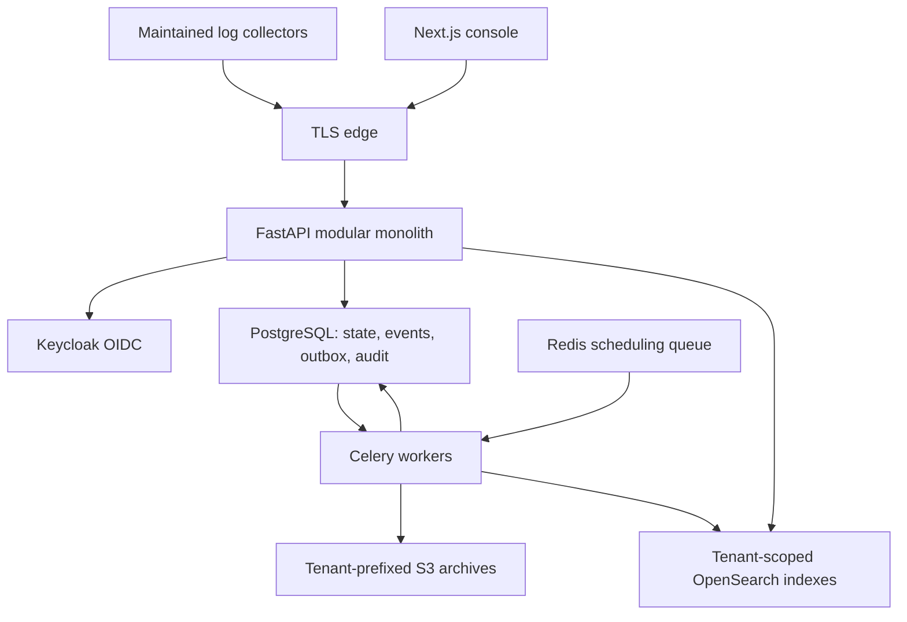

# Architecture and implementation plan

## Assumptions

The upstream repository was empty when inspected on 2026-11-11. This implementation starts a new private SaaS application without accessing existing KernelHub servers. Local use is single-node. Cloud reference deployment assumes an operator supplies a VM and managed/private backing services. No provider, region, budget, or live domain is assumed.

The initial unit is an organization with one default workspace. All organization members can access its workspaces; per-workspace roles are deferred. Platform administrators create organizations but require explicit membership to read customer information. Analysts receive access only through accepted invitations.

## Boundaries

Business services are in `backend/secops/service.py`. The HTTP layer validates request contracts and handles sessions. Adapters own search and object storage access. Splitting these into network services is unnecessary for this pilot.

## Persistence model

| Data | Ownership and constraints |
|---|---|
| users, sessions, OIDC states | Global authentication records; opaque session hashes and short expiry |
| organizations, workspaces | Workspace has an organization; composite key supports tenant-safe references |
| memberships | Organization + user primary key; org_admin / analyst / viewer |
| invitations | Single-use random token hash, verified email binding, 48-hour expiry |
| sources, credentials | Organization/workspace source; hashed ingestion credentials; scoped API credentials |
| events | Tenant/source/external ID uniqueness; source and ingestion times; normalized document and redacted original |
| outbox | One job per event; tenant/event composite foreign key; durable state, retries and error code |
| rule_settings, alerts | Tenant-specific tuning; immutable rule/tuning snapshot and evidence IDs on an alert |
| incidents, entries, alert links | Tenant-safe composite foreign keys; analyst entries and audited lifecycle |
| audit | Append-only administrative trail separate from customer event ingestion |

SQL migrations use portable relational types. Versioned event documents are JSON serialized into text columns rather than a database-specific JSON query API; indexed relational columns support correlation. PostgreSQL is the only deployed application database. SQLite is confined to test setup and cannot be enabled through runtime configuration.

## Ingestion transaction

1. Enforce a 1 MiB HTTP body cap, including chunked requests; reject compressed bodies.
2. Hash and verify the ingestion credential, expiry, revocation and source. Derive organization/workspace from the credential.
3. Lock the organization row. Enforce rate limits, daily new-event quota and a 10,000-job tenant backlog ceiling.
4. Normalize the full batch, at most 100 events and 32 KiB per event. Reject a malformed batch atomically and persist a parser failure counter/audit entry.
5. Resolve duplicates by organization + source + external ID. Persist redacted originals, normalized events and outbox rows in one SQL transaction.
6. Respond `202` only after commit. This means **durable acceptance**, not indexed or detected yet.
7. Celery beat enqueues a drain every five seconds. Workers lock an organization before handling a ready job. No browser or queue payload supplies the tenant.
8. Write to a stable S3 key, index by stable event ID, evaluate deterministic rules, and commit alerts and job completion. Failures retry after bounded backoff; the eighth external failure becomes a dead letter.

Worker termination before SQL commit rolls back processing. External operations may already have succeeded: repeating the same object key and search ID is idempotent. Alert fingerprints include rule version, tuning, correlation key and a ten-minute source-time bucket. Archive/index operations precede detection, so a search outage delays new alerts as well as indexing. Accepted evidence remains in SQL. This dependency is a deliberate first-slice limitation.

## Incremental implementation

1. Tenant-authorized database services, normalization, durable ingestion and test adapters.
2. Real OpenSearch/S3 adapters, deterministic rules, alert evidence and incidents.
3. OIDC/PKCE, sessions/CSRF, invitations and scoped credentials.
4. Next.js console, Docker local stack, CI and cloud VM reference.
5. Required validation: real identity/OTP flow, HTTP tests, actual services, browser build, restart/failure checks, deployment and restore drill.
6. Pilot hardening: automated retention/deletion, storage quotas, notifications, measured load testing, audit export to immutable independent storage, operational rollout.

Phase 1 is not approved until step 5 passes. Phase 2–4 work stays in [STATUS.md](STATUS.md).

## Failure domains

The local VM, edge, API process, PostgreSQL instance, Redis instance, scheduler, OpenSearch node, object store, and Keycloak instance are single points of failure. Multiple workers do not make the deployment highly available. Cloud reference availability depends on the separately provisioned backing services and VM; no failover has been implemented or tested.
